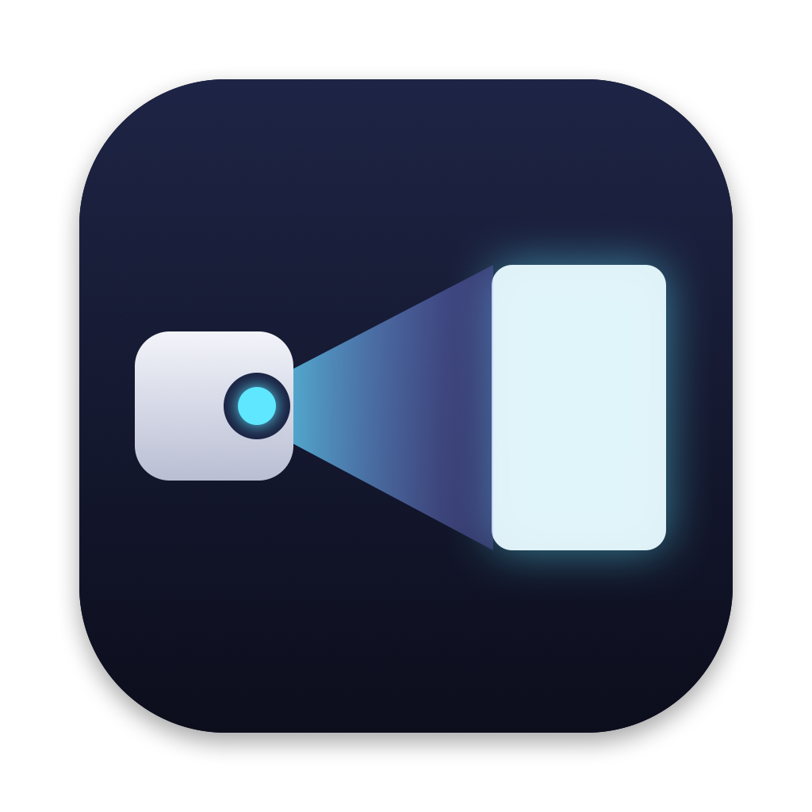

<p align="center">
  
</p>

# BeamBar

A macOS menu bar remote for Google TV and Android TV projectors and TVs, built and tested with an XGIMI projector. It controls the device over Wi-Fi: a floating glass remote, a command-line tool, a phone remote, global hotkeys, scenes, automations, voice search and casting from your Mac.

Unofficial; not affiliated with XGIMI or Google.

## Install

Tested on macOS 15. Needs Python 3.10 or newer (`brew install python@3.12` if you don't have it).

```sh
git clone https://github.com/manoj6418/BeamBar.git
cd BeamBar
./install.sh
```

The script creates a virtual environment, installs the dependencies, puts the `beambar` command on your PATH and starts the app. Then:

1. Turn on the TV or projector and make sure it's on the same Wi-Fi as your Mac.
2. Click the BeamBar icon (a small projector) in the menu bar. BeamBar finds the device by itself; if there are several, choose one under **Devices**.
3. Choose **Pair with TV…** and type the code shown on the screen. Pairing is a one-time step per device.
4. For global hotkeys, allow BeamBar under **System Settings → Privacy & Security → Accessibility** when asked.

Use **BeamBar menu → Start at login** to keep it running. To restart it: `./run.sh`. Logs: `~/Library/Logs/beambar.log`. Settings: `~/.config/beambar/config.json` (edit, then restart).

## Command line (`beambar`)

```sh
beambar volume 40        beambar vol +5          beambar mute
beambar up / down / left / right / ok / back / home / settings / input
beambar play / pause / playpause / next / previous / subtitles
beambar app Netflix      beambar open https://youtu.be/…      beambar open stranger things
beambar type hello       beambar scene "Movie night"
beambar sleep 30         beambar sleep cancel    beambar standby    beambar wake
beambar skip -30         beambar seek 600        beambar cast ~/Movies/clip.mp4
beambar remote show | hide | toggle | mini
beambar device <name>    beambar status          beambar help
```

The command talks to the running app over a local socket, so anything that can run a shell command can drive the TV:

- **Shortcuts / Siri:** new Shortcut → "Run Shell Script" → `beambar scene "Movie night"` → name it "Movie night" → "Hey Siri, Movie night".
- **Raycast:** a Script Command with `#!/bin/zsh` and `beambar volume 40`.
- **Stream Deck:** "System → Open" pointing at a small `.command` file that calls `beambar …`.

## Floating remote

- **BeamBar menu → Show remote**, `⌃⌥R` from anywhere, or `beambar remote toggle`.
- The red dot hides it, the yellow dot collapses it to a compact bar (`⌘M`). It remembers where you left it.
- Touch surface: swipe to navigate, click for OK. During playback, a horizontal drag scrubs with a live ±seconds preview.
- `⌘K` or `/` opens the command palette: every command above, plus free text as a YouTube search with results (and TMDB posters if you set `tmdb_api_key`).
- `T` types straight into the TV, hold `V` (or the mic button) for voice search, `⌘V` opens a pasted link.
- While it's focused: arrows, Return, Esc, Space, H, M, S, + / −.

## Global hotkeys

`⌃⌥` plus arrows, Return (OK), Delete (Back), Space (play/pause), H (home), M (mute), = / − (volume), R (show or hide the remote). Change them under `hotkeys` in the config.

## Menu bar

Click the BeamBar icon for the **control center**: the device and its status, what's playing (with progress and playback controls), volume, your apps and scenes, and quick buttons for the remote, the phone QR code, opening a link and typing. Right-click (or Ctrl-click) the icon for the full menu. `beambar center` opens it from Shortcuts or Raycast.

Scroll on the menu bar icon to change the volume. Set `"menubar": "nowplaying"` to show what's playing instead of the volume.

## Phone remote

Choose **BeamBar menu → Phone remote (QR code)…** (or run `beambar phone`) and point your phone's camera at the code. It opens `http://beambar.local:8788`, a link that stays the same even when your Mac's IP address changes. If a phone can't open `.local` links (some Android phones), the panel switches to the IP address. Add it to the home screen for an app-like remote.

It works on the local network only and has no password; turn it off with `"phone_remote": false`.

## Scenes

```json
"scenes": {
  "Movie night": [{"launch": "https://www.netflix.com/title"}, {"volume": 40}],
  "Bedtime": [{"volume": 15}, {"sleep_in": 30}]
}
```

Steps: `launch` (an https link), `volume`, `key`, `sleep_in` (minutes), `standby`, `wait` (seconds).

## Automations

```json
"automations": [
  {"when": "time", "at": "23:30", "do": "sleep 30"},
  {"when": "mac_sleep", "do": "standby"},
  {"when": "projector_online", "do": "remote show"},
  {"when": "app_changed", "app": "Netflix", "do": "volume 40"},
  {"when": "media_ended", "do": "notify Episode finished"}
]
```

Triggers: `projector_online`, `projector_offline`, `app_changed` (optional `app` filter), `media_started`, `media_ended`, `mac_sleep`, `mac_wake`, `mac_lock`, `mac_unlock`, `time` (`at: "HH:MM"`). `do` is any command above, or `notify <text>`. Add `"enabled": false` to pause a rule.

## Devices

**BeamBar menu → Devices → Find devices on the network…** adds every Google TV / Android TV device that answers. Switch from the menu, the name on the remote, or `beambar device <name>`. Each device needs its own pairing.

## Cast from your Mac

**BeamBar menu → Cast from this Mac** plays a local file (MP4, MOV, WebM, MP3, images; served from your Mac on port 8765) or a direct URL. **Send current browser tab** (`⌘T` in the menu) opens the front Chrome, Brave, Edge or Safari tab on the TV; YouTube links play directly.

## Game controller

An Xbox, PlayStation or Switch Pro controller paired to the Mac works automatically: left stick or d-pad to navigate, A/Cross for OK, B/Circle for Back, X/Square for play/pause, Y/Triangle for Home, bumpers for volume. `"controller": false` turns it off.

## Options

`haptics` (trackpad taps on presses), `sounds`, `typing_mode` (`keys` | `replace` | `insert`), `tmdb_api_key`, `phone_remote`, `controller`, `menubar`.

## What works and what doesn't

- Over Wi-Fi: keys, apps (https links only), text, voice, volume, media controls, now playing, YouTube playback.
- Device-specific settings (focus, keystone, picture modes on XGIMI projectors) aren't reachable this way; they need ADB with *Developer options → Network/Wireless debugging* turned on.
- Turning a device on from fully off needs the physical remote's Bluetooth wake signal, which macOS can't send. An ESP32 running the `esp32-bluetooth-proxy-xgimi-wake` ESPHome package can.

## Privacy

Everything stays on your network. The only outside requests are YouTube and TMDB searches when you use the command palette (TMDB only if you add your own key). Pairing keys live in `~/.config/beambar/`.

## Thanks

Built on [androidtvremote2](https://github.com/tronikos/androidtvremote2), [PyChromecast](https://github.com/home-assistant-libs/pychromecast), [rumps](https://github.com/jaredks/rumps) and [PyObjC](https://github.com/ronaldoussoren/pyobjc).
